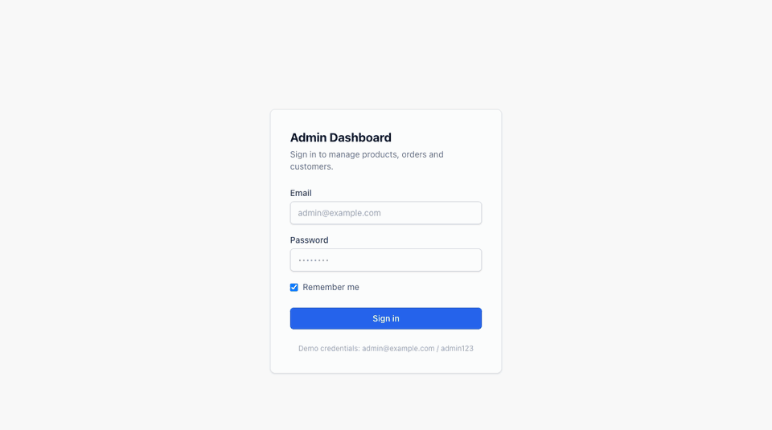
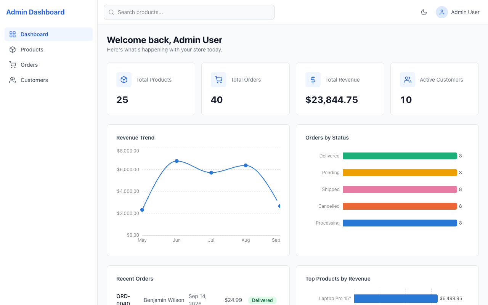
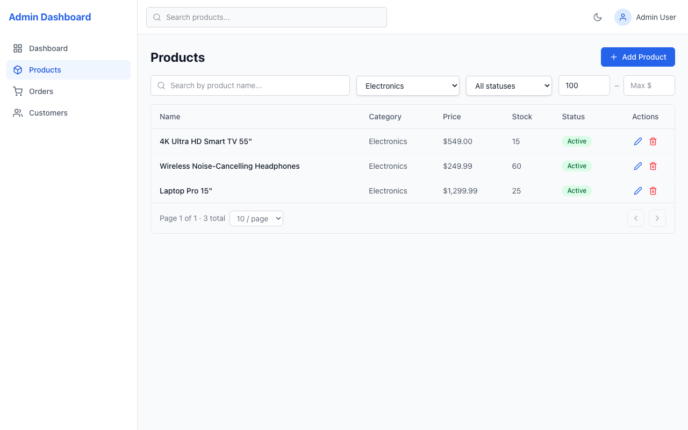
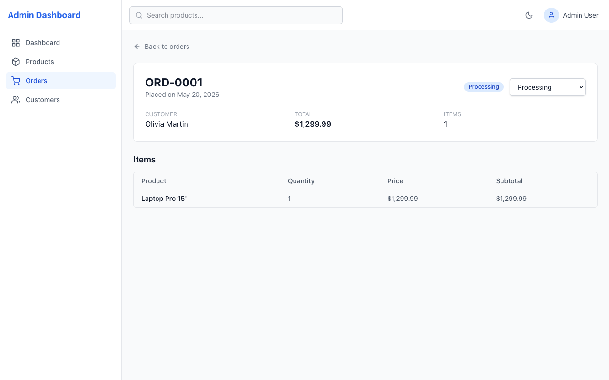
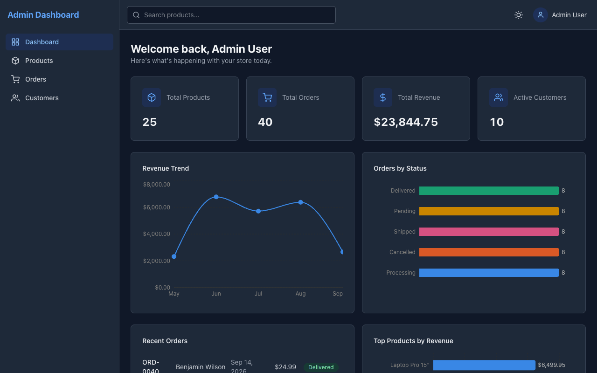

# E-Commerce Admin Dashboard

[](https://github.com/nurlanmusayev2000/ecommerce-admin-dashboard/actions/workflows/ci.yml)

An admin dashboard for managing an online store's products, orders and customers. It is built with React, TypeScript and Redux Toolkit, and runs entirely in the browser: a mock API built with Mock Service Worker serves the data, so no backend is needed.



## Features

- **Dashboard:** KPI cards, a revenue trend, an order status breakdown, top products by revenue and recent orders.
- **Products:** search, filter by category, status and price range, sort, paginate, and create, edit or delete products.
- **Orders:** search by order number, filter by status, sort, paginate, view item breakdowns and update order status.
- **Customers:** search, sort, paginate and view each customer's order history.
- **Authentication:** mock JWT sign-in with protected routes and a persisted session.
- **UI:** dark mode, toast notifications, loading skeletons, error boundaries and lazily loaded routes.

| Dashboard | Products, filtered |
| --- | --- |
|  |  |
| **Order detail** | **Dark mode** |
|  |  |

## Tech stack

| Area | Library |
| --- | --- |
| UI | React 19, Tailwind CSS 4, React Icons |
| Language | TypeScript 6 |
| State and data fetching | Redux Toolkit 2 with RTK Query, React Redux 9 |
| Routing | React Router 7 |
| Forms | React Hook Form 7 |
| Charts | Recharts 3 |
| Mock API | MSW 2 (in the browser), json-server 1.0 beta (local server) |
| Build | Vite 8 |
| Testing | Vitest 5, React Testing Library 16 |
| Linting | oxlint |

## Architecture decisions

### Why RTK Query

Most of the app's state is server data: lists that are paginated, filtered and sorted, plus records that change. RTK Query handles fetching, caching, loading and error states, and keeps the data up to date, so components don't need hand-written thunks or reducers for it.

- **One API slice, split by feature.** `baseApi` sets the base URL and attaches the auth token. `productsApi`, `ordersApi`, `customersApi` and `dashboardApi` add their endpoints with `injectEndpoints`.
- **Cache tags keep lists up to date.** Each query provides tags such as `{ type: 'Product', id }` and `{ type: 'Product', id: 'LIST' }`. Mutations invalidate them, so after you edit a product, both its detail page and the product list refetch automatically.
- **Derived data.** The dashboard endpoint uses `queryFn` to fetch products, orders and customers in parallel and compute KPIs and chart data from them. It provides the `LIST` tags, so it refreshes after any change.
- **Plain Redux for client state.** Authentication, dark mode and each table's filters, sort and page live in small slices. Filters are kept when you navigate away and come back.

### Running without a backend: MSW

Locally, the API can be [json-server](https://github.com/typicode/json-server), seeded from `db.json`. A static site has no server to run it on, so the same API is also served inside the browser by [MSW](https://mswjs.io) (Mock Service Worker):

1. `main.tsx` registers a service worker, `public/mockServiceWorker.js`, before React renders. A service worker can intercept every request the page makes, so it catches RTK Query's API calls before they reach the network.
2. The worker passes each request to the handlers in `src/mocks/handlers.ts`, which reproduce json-server's REST routes and status codes. RTK Query can't tell it isn't talking to a real server, so the API code is the same in both modes.
3. `src/mocks/jsonServerQuery.ts` reimplements the json-server features the app uses: `_page`/`_per_page` pagination, `_sort=field` and `_sort=-field`, and operator filters such as `price:gte=50`. It returns the same results as json-server for every query the app sends.
4. `src/mocks/db.ts` keeps the data in memory, starting from `db.json`. Changes are saved to localStorage, so they survive a reload. When `db.json` changes, saved data is discarded.

The mock API is on by default in production builds and when you run `npm run dev:mock`. `VITE_USE_MOCK_API=true` or `false` overrides this. In mock mode, requests go to the same-origin `/api` path.

### Folder structure

```
src/
├── app/            # Redux store and typed hooks
├── components/
│   ├── common/     # Reusable UI: Button, Modal, Pagination, skeletons, Toast...
│   ├── layout/     # Header, Sidebar and the layout shell
│   └── features/   # Feature components: Products, Orders, Customers, Dashboard
├── hooks/          # useAuth, useToast, useDebounce
├── mocks/          # MSW worker, handlers, json-server query engine, in-memory db
├── pages/          # Route-level components, lazily loaded
├── services/
│   ├── api/        # RTK Query API slices
│   └── auth/       # Mock auth service
├── store/slices/   # auth, ui and filter slices
├── types/          # Shared TypeScript types
└── utils/          # Formatters, validators, constants
```

## Running locally

```bash
npm install
npm run dev:mock   # http://localhost:5173, no server needed
```

Sign in with **admin@example.com** / **admin123**. Your changes are saved in the browser's localStorage. To start again from `db.json`, clear the site data.

To run against a real json-server instead:

```bash
npm run dev:full   # Vite on 5173 and json-server on 3001
```

json-server writes changes back to `db.json`, so check `git diff db.json` before committing.

| Script | What it does |
| --- | --- |
| `npm run dev:mock` | Vite dev server with the in-browser MSW API |
| `npm run dev:full` | Vite dev server and json-server together |
| `npm run dev` | Vite dev server only, expecting an API on port 3001 |
| `npm run server` | json-server only |
| `npm run build` | Type-check and build for production |
| `npm run preview` | Serve the production build, which uses MSW |
| `npm run test` | Run the tests with Vitest in watch mode |
| `npm run lint` | Run oxlint |

## Testing

```bash
npm run test -- --run   # run the suite once, without watch mode
npm run test            # watch mode
```

Vitest runs the tests in jsdom with React Testing Library.

**Integration tests** (`src/tests/integration/`) render the whole app at a URL, with a fresh Redux store for each test. The API is served by the app's own MSW handlers through `msw/node`. So every request goes through RTK Query, `fetch` and the same json-server-compatible handlers and `db.json` data the app uses in production. Expected results are computed from `db.json`, and the data is reset after each test.

- **Products page:**
  - The list loads, and search, category and price filters, sorting and pagination all work.
  - Creating, editing and deleting a product updates the list afterwards.
  - Form validation runs before saving, and cancelling a delete keeps the product.
- **Orders page:**
  - Filtering by status works.
  - Updating an order's status from its detail page changes it, and the list then shows the order under its new status.
  - A failed update shows an error and keeps the old status.
- **Protected routes:**
  - Opening `/products` (or any other page) while logged out redirects to `/login` without calling the API.
  - Logging in returns you to the page you asked for, and logging out goes back to `/login`.

**Unit tests:**

- **Components and pages:** `Button` and `LoginPage`, including form validation and signing in with the demo credentials.
- **Utilities:** formatters and validators.
- **Mock API:** the query engine's filtering, sorting and pagination, the in-memory database and its persistence, and the MSW handlers.

[GitHub Actions](.github/workflows/ci.yml) runs lint, build and the tests on Node 22 for every push and pull request.
